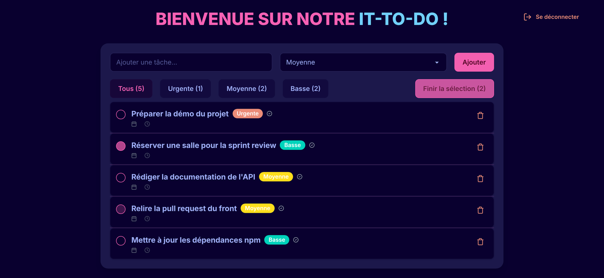
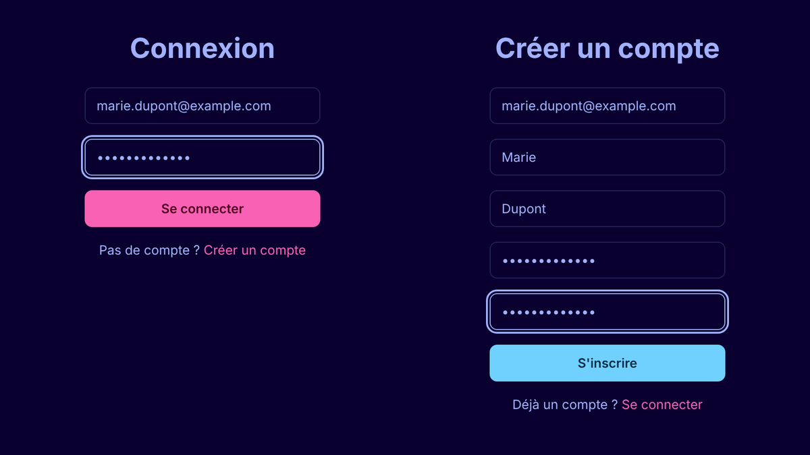
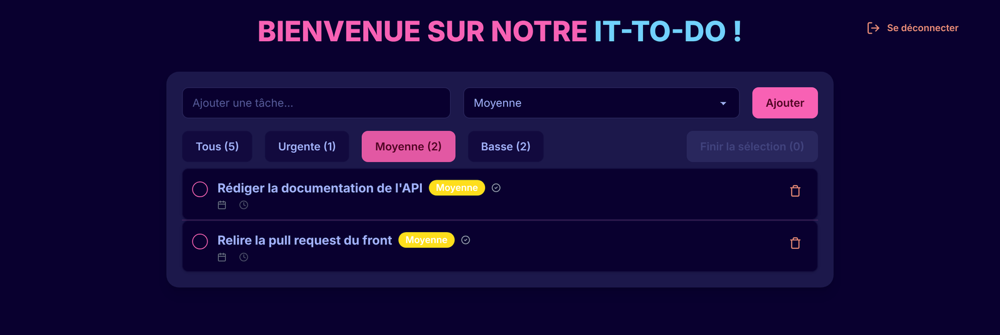
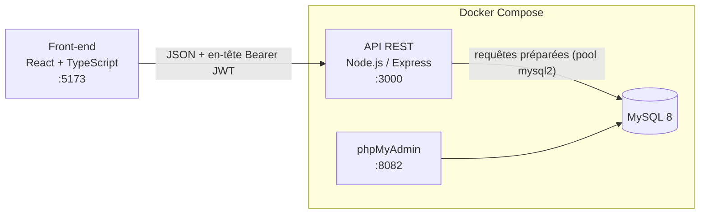
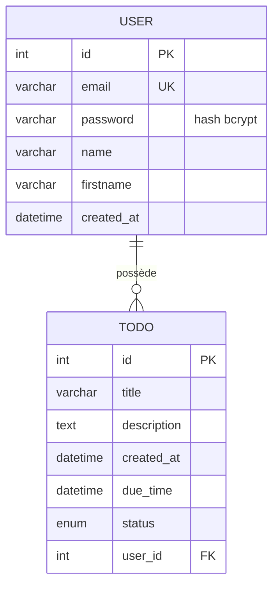

<h1 align="center">E-Todo</h1>

<p align="center">
  Application de gestion de tâches <b>full-stack</b> : API REST sécurisée par JWT, base MySQL et interface React + TypeScript.
</p>

<p align="center">
  
  
  
  
  
  
  
  
</p>

<p align="center">
  
</p>

---

## Sommaire

- [À propos](#à-propos)
- [Fonctionnalités](#fonctionnalités)
- [Stack technique](#stack-technique)
- [Architecture](#architecture)
- [Démarrage rapide](#démarrage-rapide)
- [Documentation de l'API](#documentation-de-lapi)
- [Modèle de données](#modèle-de-données)
- [Structure du projet](#structure-du-projet)
- [Points techniques](#points-techniques)
- [Roadmap](#roadmap)
- [Auteur](#auteur)

## À propos

**E-Todo** est une application web de gestion de tâches réalisée dans le cadre du cursus **Epitech**.
L'objectif : concevoir de bout en bout une application complète, de la base de données jusqu'à l'interface :

- une **API REST** en Node.js / Express, avec inscription, connexion et routes protégées par **JSON Web Token** ;
- une base **MySQL** initialisée automatiquement via Docker ;
- un **front-end React + TypeScript** qui consomme l'API.

## Fonctionnalités

**Côté utilisateur**
- Création de compte (avec confirmation du mot de passe) et connexion
- Session persistante grâce au JWT stocké côté client, déconnexion en un clic
- Ajout de tâches avec un niveau de priorité : **Urgente**, **Moyenne** ou **Basse**
- Filtres par priorité avec compteurs en temps réel
- Sélection multiple et clôture groupée des tâches
- Suppression unitaire d'une tâche
- Interface sombre (thème *synthwave* de daisyUI) et icônes Lucide

**Côté API**
- CRUD complet sur les tâches (`/todos`)
- Gestion du profil et des comptes (`/user`, `/users/:id`)
- Hachage des mots de passe avec **bcrypt**
- Middleware d'authentification JWT sur toutes les routes privées
- Codes HTTP et messages d'erreur cohérents (`400`, `401`, `404`, `500`)

<p align="center">
  
</p>
<p align="center">
  
</p>

## Stack technique

| Couche | Technologies |
| :--- | :--- |
| **Front-end** | React 19, TypeScript, Vite, React Router, Tailwind CSS 4, daisyUI, lucide-react |
| **Back-end** | Node.js, Express, jsonwebtoken, bcryptjs, mysql2, dotenv |
| **Base de données** | MySQL 8 |
| **Outillage** | Docker, Docker Compose, phpMyAdmin, ESLint |

## Architecture



## Démarrage rapide

### Prérequis

- [Docker](https://docs.docker.com/get-docker/) et Docker Compose
- [Node.js](https://nodejs.org/) 20.19+ (pour le front-end Vite)

### Installation

```bash
# 1. Cloner le dépôt
git clone https://github.com/klasken/Etodo.git
cd Etodo

# 2. Créer le fichier d'environnement, puis personnaliser les mots de passe et le secret JWT
cp .env.example .env

# 3. Lancer l'API, la base MySQL et phpMyAdmin
docker compose up -d --build

# 4. Lancer le front-end
cd frontend
npm install
npm run dev
```

| Service | URL |
| :--- | :--- |
| Application web | http://localhost:5173 |
| API REST | http://localhost:3000 |
| phpMyAdmin | http://localhost:8082 |

> Au premier démarrage, MySQL exécute automatiquement `e-todo.sql` pour créer les tables.

### Variables d'environnement

| Variable | Description | Exemple |
| :--- | :--- | :--- |
| `MYSQL_HOST` | Hôte MySQL vu par l'API (nom du service Docker) | `mysql` |
| `MYSQL_DATABASE` | Nom de la base | `etodo` |
| `MYSQL_USER` | Utilisateur applicatif créé au premier démarrage | `etodo` |
| `MYSQL_PASSWORD` | Mot de passe de cet utilisateur | `change_me` |
| `MYSQL_ROOT_PASSWORD` | Mot de passe root MySQL (utilisé par phpMyAdmin) | `change_me_too` |
| `PORT` | Port de l'API (le front-end appelle `http://localhost:3000`) | `3000` |
| `SECRET` | Clé de signature des JWT | longue chaîne aléatoire |

> Le fichier `.env` est ignoré par Git : seuls les exemples de `.env.example` sont versionnés.

## Documentation de l'API

Toutes les routes échangent du JSON. Les routes marquées 🔒 exigent l'en-tête :

```http
Authorization: Bearer <token>
```

Le token est renvoyé par `/register` et `/login` et reste valide **1 heure**.

### Authentification

| Méthode | Route | Corps | Réponse |
| :--- | :--- | :--- | :--- |
| `POST` | `/register` | `email`, `password`, `firstname`, `name` | `201` `{ "token": "..." }` |
| `POST` | `/login` | `email`, `password` | `200` `{ "token": "..." }` |

### Utilisateurs

| Méthode | Route | Description |
| :--- | :--- | :--- |
| `GET` | `/user` 🔒 | Profil de l'utilisateur connecté |
| `GET` | `/user/todos` 🔒 | Tâches de l'utilisateur connecté |
| `GET` | `/users/:id` ou `/users/:email` 🔒 | Récupérer un utilisateur par id ou e-mail |
| `PUT` | `/users/:id` 🔒 | Mettre à jour un utilisateur (`email`, `password`, `firstname`, `name`) |
| `DELETE` | `/users/:id` 🔒 | Supprimer un utilisateur et ses tâches |

### Tâches

| Méthode | Route | Description |
| :--- | :--- | :--- |
| `GET` | `/todos` 🔒 | Lister les tâches |
| `GET` | `/todos/:id` 🔒 | Récupérer une tâche |
| `POST` | `/todos` 🔒 | Créer une tâche (`title`, `description`, `due_time`, `status`, `user_id`) |
| `PUT` | `/todos/:id` 🔒 | Mettre à jour une tâche (mêmes champs) |
| `DELETE` | `/todos/:id` 🔒 | Supprimer une tâche |

`status` accepte : `not started`, `todo`, `in progress`, `done`.

### Exemples

```bash
# Inscription : renvoie un JWT
curl -X POST http://localhost:3000/register \
  -H "Content-Type: application/json" \
  -d '{"email":"marie@example.com","password":"secret","firstname":"Marie","name":"Dupont"}'

# Création d'une tâche
curl -X POST http://localhost:3000/todos \
  -H "Authorization: Bearer <token>" \
  -H "Content-Type: application/json" \
  -d '{"title":"Préparer la démo","description":"Urgente","due_time":"2026-12-31 23:59:59","status":"todo","user_id":1}'
```

```json
{
  "id": 1,
  "title": "Préparer la démo",
  "description": "Urgente",
  "created_at": "2026-11-09T14:48:05.000Z",
  "due_time": "2026-12-31T22:59:59.000Z",
  "status": "todo",
  "user_id": 1
}
```

| Code | Signification |
| :--- | :--- |
| `400` | Paramètre manquant ou token absent |
| `401` | Identifiants invalides ou token invalide / expiré |
| `404` | Ressource introuvable |
| `500` | Erreur interne du serveur |

## Modèle de données



La suppression d'un utilisateur entraîne celle de ses tâches (`ON DELETE CASCADE`).

## Structure du projet

```text
Etodo/
├── backend/
│   ├── src/
│   │   ├── config/db.js          # Pool de connexions MySQL
│   │   ├── middleware/auth.js    # Vérification du JWT
│   │   ├── routes/
│   │   │   ├── auth.js           # /register, /login
│   │   │   ├── todos.js          # CRUD /todos
│   │   │   └── user.js           # /user, /users/:id
│   │   └── index.js              # Serveur Express et CORS
│   ├── Dockerfile
│   └── package.json
├── frontend/
│   ├── src/
│   │   ├── pages/                # Connexion, inscription, liste des tâches
│   │   ├── TodoItem.tsx          # Composant d'une tâche
│   │   ├── App.tsx               # Routing (React Router)
│   │   └── main.tsx
│   ├── vite.config.ts
│   └── package.json
├── docs/screenshots/             # Captures d'écran du README
├── docker-compose.yml            # API + MySQL + phpMyAdmin
├── e-todo.sql                    # Schéma de la base
└── .env.example                  # Modèle de configuration
```

## Points techniques

- **Sécurité des mots de passe** : hachage `bcrypt` avec sel avant tout stockage.
- **Authentification stateless** : JWT signé côté serveur, vérifié par un middleware Express réutilisable, avec expiration d'une heure.
- **Protection contre l'injection SQL** : toutes les requêtes passent par des requêtes préparées (`?`) de `mysql2`.
- **Performance** : pool de connexions MySQL partagé par toutes les routes.
- **Intégrité des données** : contraintes `UNIQUE` sur l'e-mail, clé étrangère et suppression en cascade.
- **Environnement reproductible** : un seul `docker compose up` lance l'API, la base initialisée et phpMyAdmin.
- **Front-end typé** : TypeScript, composants réutilisables et routing côté client.

## Roadmap

- [ ] Afficher et modifier l'échéance et le statut des tâches dans l'interface (déjà gérés par l'API)
- [ ] Durcir les autorisations : limiter `/todos` et `/users/:id` aux données de l'utilisateur connecté
- [ ] Ne plus renvoyer le hash du mot de passe dans les réponses `/user`
- [ ] Rendre l'URL de l'API configurable (`VITE_API_URL`) et conteneuriser le front-end
- [ ] Ajouter des tests automatisés (Jest + Supertest) et une CI GitHub Actions

## Auteur

**Marius Ceugniet**, étudiant à Epitech
[GitHub @klasken](https://github.com/klasken)
